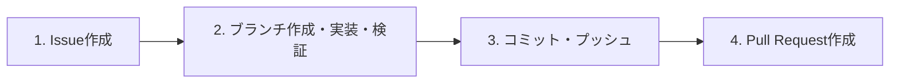

# AGENTS.md

このリポジトリで作業を行うすべてのAIエージェントおよび開発者が遵守すべき開発ガイドライン・行動指針です。

---

## 1. 最重要原則（絶対遵守事項）

すべての作業において、以下の5原則を最優先で適用してください。

1. **要件定義の必読**: 作業開始時および各タスク着手時には、必ず要件定義ファイル（仕様書・設計書等）を精読し、仕様から逸脱しない実装を行うこと。
2. **日本語記述の徹底**: コード内コメント（JSDoc / Docstring等）、ドキュメント、コミットメッセージ、Issue、Pull Request（PR）はすべて**日本語**で記述すること。
3. **絵文字の完全禁止**: ドキュメント全般（README、仕様書、Markdownファイル、Issue、PR、コミットメッセージ等）において、絵文字は一切使用しないこと。
4. **都度コミット・プッシュ**: 変更を放置したり無関係な変更を一度にまとめたりせず、論理的な作業単位ごとに必ずコミットを作成し、即座にリモートブランチへプッシュすること。
5. **作業エージェントのモデル名明記**: コーディング、設計、ドキュメント作成等の作業を行ったAIエージェントのモデル名（例: Gemini 3.8 Flash, Claude 3.5 Sonnet, GPT-4o 等、実際に作業したモデル名）を、README.md、Issue、Pull Request（PR）などの必要な箇所に必ず明記すること。

---

## 2. 品質基準・実装規約

### 2.1 セキュリティ
- **機密情報の保護**: APIキー、トークン、パスワード、秘密鍵などをコード内やコミット履歴に含めないこと。機密情報は環境変数（`.env` 等）で管理し、`.gitignore` に登録されていることを必ず確認する。
- **入力値の検証とサニタイズ**: 外部からの入力値（ユーザー入力、外部APIレスポンス、クエリパラメータ等）は必ずバリデーションとサニタイズを行い、インジェクション脆弱性や予期せぬ例外を防止する。
- **依存関係の安全性**: 信頼できるライブラリのみを採用し、既知の脆弱性（CVE等）が含まれていないか確認する。
- **最小権限の原則**: システム、API、ファイル操作において、必要最小限の権限のみを要求・付与する設計を徹底する。

### 2.2 パフォーマンスとリソース管理
- **計算量の最適化**: 時間計算量・空間計算量を意識し、不要なループ処理やN+1問題、高負荷な同期処理を避ける。
- **I/O・ネットワークの効率化**: 不要なファイルアクセスや過剰なAPIコールを抑制し、キャッシュ機構や非同期処理（バッチ処理・並列処理）を適切に活用する。
- **リソース解放の徹底**: ファイルディスクリプタ、データベース接続、イベントリスナー、ストリーム等の解放漏れやメモリリークを防ぐ。

### 2.3 ドキュメントの同期
- コードの追加・修正や仕様変更を行った際は、同一タスク内で関連するすべてのドキュメント（README、仕様書、APIドキュメント等）を最新の状態に更新する。
- README.md、Issue、PR等には、実装やドキュメント生成、要件定義を担当したAIモデル名（例: Gemini 3.8 Flash 等）を必ず明記すること。

---

## 3. Git運用規則

### 3.1 ブランチ命名規則
ブランチ名は必ず `[GitHubユーザー名]/[プレフィックス]/issue-[番号]-[概要]` の形式で命名してください。

- **フォーマット**: `<GitHubユーザー名>/<type>/issue-<番号>-<英語の簡潔な概要>`
- **プレフィックス（type）一覧**:
  - `feature`: 新機能開発
  - `fix`: バグ修正
  - `docs`: ドキュメントのみの変更
  - `refactor`: 仕様変更を伴わないリファクタリング
  - `test`: テストコードの追加・修正
  - `chore`: ビルド設定や依存関係などの雑務
- **命名例**:
  - `rainyskybow/feature/issue-1-user-auth`
  - `rainyskybow/fix/issue-2-crash-bug`

### 3.2 コミットメッセージ規約
コミットメッセージはプレフィックスに続けて**日本語**で記述し、変更の意図と範囲が追跡できるように分割してください。

- **フォーマット**: `<type>: <変更内容の要約（日本語）>`
- **記述例**:
  - `feat: キャラクターシート取得機能の実装`
  - `fix: 入力値の検証処理を修正`
  - `docs: 要件定義変更に伴いREADMEの設定手順を更新`

---

## 4. 開発ワークフロー

機能開発やバグ修正などのタスクは、必ず以下の4ステップを順番に実行してください。



### ステップ 1: Issueの作成
1. 作業着手前に要件定義ファイルを確認し、タスクの目的・要件・影響範囲を整理する。
2. 後述の「**5.1 Issueテンプレート**」に沿ってIssueを作成し、完了条件を明確化する。

### ステップ 2: ブランチ作成・実装・検証・ドキュメント更新
1. 作成したIssue番号に基づき、命名規則に従って作業用ブランチを作成する。
2. 要件定義および品質基準（セキュリティ・パフォーマンス）に準拠して実装を行う。
3. テストコードの追加・実行、およびエッジケースを含む動作確認を行う。
4. 実装内容に合わせて関連ドキュメントを最新化する。

### ステップ 3: コミットおよびプッシュの実行
1. 変更内容を論理的な単位（機能追加、テスト追加、ドキュメント更新など）に分割する。
2. 作業の区切りごとに日本語のコミットメッセージでコミットを作成し、リモートブランチへプッシュする。

### ステップ 4: Pull Request (PR) の作成
1. すべての完了条件を満たしていることを確認し、メインブランチへ向けてPRを作成する。
2. 後述の「**5.2 Pull Requestテンプレート**」に沿って記述し、`Closes #<Issue番号>` で関連Issueを必ずリンクする。

---

## 5. テンプレート

### 5.1 Issueテンプレート

```markdown
## 概要
- 背景や解決したい課題、このタスクの目的を簡潔に記述する。

## 実装する内容
- [ ] 実装・修正する具体的な機能や処理項目1
- [ ] 実装・修正する具体的な機能や処理項目2
- [ ] 関連ドキュメントの更新

## 完了条件（受け入れ基準）
- [ ] 要件定義書の仕様を満たしていること
- [ ] 正常系および異常系（エラーハンドリング・バリデーション）の動作が確認できていること

## 作業情報
- 作業担当モデル: <使用したモデル名>

## その他
- 関連する仕様書の参照箇所、技術的な制約事項、影響範囲などの補足事項（特になければ「なし」と記載）
```

### 5.2 Pull Requestテンプレート

```markdown
## 概要
- Closes #<Issue番号>
- このPRで行った変更の目的と要約を簡潔に記述する。

## 実装した内容
- 実装・変更した具体的な処理やファイルの内容1
- 実装・変更した具体的な処理やファイルの内容2
- 更新したドキュメントの内容

## 動作確認・テスト内容
- [ ] 既存の機能・テストが正常に通ること
- [ ] 追加・修正した機能の正常系および異常系テストを実施済みであること
- [ ] 機密情報の混入や不要なデバッグコードが残っていないこと

## 作業情報
- 作業担当モデル: <使用したモデル名>

## その他
- レビュワーへの伝達事項、環境変数の追加有無、今後の課題などの補足事項（特になければ「なし」と記載）
```
