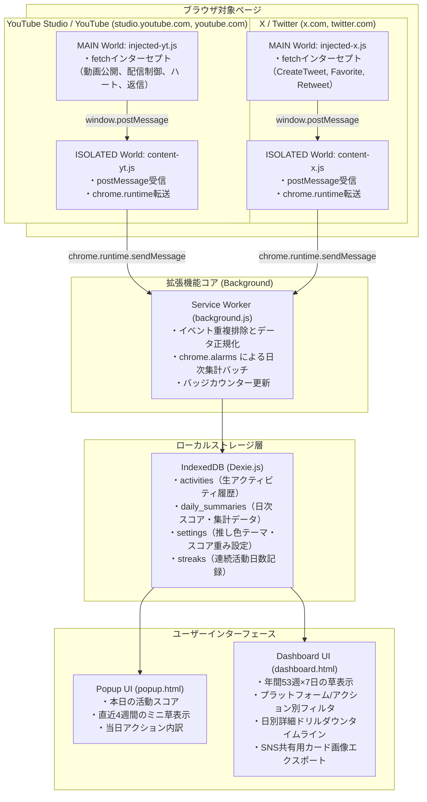

# 要件定義書: v-activity-lawn

## 1. システム概要と目的

### 1.1 プロジェクト名
v-activity-lawn（バーチャル・アクティビティ・ローン）

### 1.2 背景と目的
VTuber、ライブ配信者、動画クリエイターにとって、日々の動画制作、長時間のライブ配信、SNSでの告知やファン交流は膨大なエネルギーを要する創作活動です。しかし、これらの活動実績はプラットフォームごとに分散しており、クリエイター自身が自らの努力の積み重ねを実感しづらいという課題があります。

本プロジェクト「v-activity-lawn」は、エンジニアがGitHubのコントリビューショングラフ（通称「草」）で自らの開発の継続を誇るように、**YouTubeの投稿・配信・ファン交流およびX（旧Twitter）での発信活動を、ブラウザ上でGitHub風の「活動草」として一元的に可視化するChrome拡張機能**です。

クリエイター自身の継続モチベーション向上、活動実績の振り返り、およびファンに向けた活動アピール（SNS共有）を支援します。

### 1.3 想定ユーザー
- 個人VTuber / バーチャルライバー
- ゲーム配信者 / 雑談配信者
- YouTube動画クリエイター（長尺動画・YouTube Shorts制作者）
- 日常的にYouTube StudioおよびXを利用して発信・活動しているコンテンツ制作者

### 1.4 基本設計方針
1. **公式API完全非依存**: Twitter API v2の高額な従量課金やYouTube Data APIのクォータ制限・OAuth審査に依存せず、完全無料で利用可能とする。
2. **アカウントBANリスクの完全排除（パッシブ検知）**: クライアントから外部へ機械的な自動巡回リクエストを行わず、ユーザーが普段行っているブラウジング時の通信・操作を受動的に傍受（パッシブ検知）することで、ボット検知や利用規約抵触リスクを排除する。
3. **完全ローカルファースト（プライバシー保護）**: 収集したアクティビティログは外部サーバーへ送信せず、すべてユーザーのブラウザ内ストレージ（IndexedDB）に暗号化・保護して完結させる。
4. **クリエイター活動量スコア（重み付け）**: 単純なアクション件数ではなく、動画編集や長時間配信などの「クリエイティブ負荷・熱量」を適切に反映した重み付けアルゴリズムを導入する。

---

## 2. システムアーキテクチャ設計

### 2.1 全体構成図（Manifest V3準拠）



### 2.2 各レイヤーの技術仕様

1. **MAIN World スクリプト（ページ内コンテキスト）**:
   - `window.fetch` を安全にモンキーパッチし、YouTube StudioおよびXの内部APIリクエストを監視。
   - レスポンスステータスが200であることを確認した上で、操作種別とメタデータを `window.postMessage` で中継。
   - 拡張機能のエラーがホストサイト本来の通信に影響を与えないよう、完全な例外ハンドリング（try-catch）を徹底。
2. **ISOLATED World コンテンツスクリプト（拡張機能コンテキスト）**:
   - MAIN Worldからの `postMessage` を購読し、送信元オリジンを検証した上で `chrome.runtime.sendMessage` でService Workerへ転送。
3. **Service Worker（バックグラウンド管理）**:
   - 受信したイベントの重複排除（同一アクションの連打防止・デバウンス処理）。
   - クリエイター活動量スコアの計算とIndexedDBへの即時永続化。
   - `chrome.alarms` による日次メンテナンス（日付跨ぎ時の集計確定、ストリーク判定）。
4. **ローカルストレージ（IndexedDB）**:
   - 大量のアクティビティログを高速かつ容量制限なく保存するため、IndexedDBを採用（Dexie.js等を使用）。

---

## 3. 機能要件

### 3.1 YouTube投稿者操作検知機能

YouTube Studio (`studio.youtube.com`) および YouTubeメインサイト (`www.youtube.com`) でのクリエイター操作を受動的に検知します。

| アクション | 検知対象エンドポイント / 手法 | 検知条件・取得データ |
| :--- | :--- | :--- |
| **動画公開（通常長尺）** | `/youtubei/v1/entity_update/update_video_metadata` または `/video_metadata/update` | `privacy: "PUBLIC"` への更新、動画ID、タイトル |
| **ショート動画公開** | 同上 | 動画の再生時間が60秒未満または縦型動画（Shorts属性）の判定 |
| **ライブ配信枠作成** | `/youtubei/v1/live_video/create_broadcast` | 枠作成成功、配信タイトル、予定配信日時 |
| **ライブ配信開始** | `/youtubei/v1/live_video/transition_broadcast` | `broadcastStatus: "LIVE"`、動画ID、開始タイムスタンプ |
| **ライブ配信終了** | `/youtubei/v1/live_video/transition_broadcast` | `broadcastStatus: "COMPLETE"`、終了タイムスタンプ、総配信時間 |
| **コミュニティ投稿** | `/youtubei/v1/backstage/create_post` | 投稿作成成功、テキスト本文、添付種別（画像/テキスト） |
| **アンケート作成** | 同上 | `pollAttachment` の存在判定、設問内容 |
| **コメント返信** | `/youtubei/v1/comment/create_comment_reply` | 返信作成成功、対象動画ID、返信日時 |
| **クリエイターハート付与** | `/youtubei/v1/comment/perform_comment_action` | `actions: ["ACTION_HEART"]` の実行成功 |
| **カスタムサムネイル更新** | `/youtubei/v1/video_metadata/save_custom_thumbnail` | サムネイル保存成功、対象動画ID |
| **メタデータ更新** | `/youtubei/v1/video_metadata/update` | タイトル・概要欄の更新成功（公開状態変更を含まない場合） |

### 3.2 X（旧Twitter）アクティビティ検知機能

X (`x.com` / `twitter.com`) における発信・交流活動を受動的に検知します。

| アクション | 検知対象エンドポイント（GraphQL） | 検知条件・取得データ |
| :--- | :--- | :--- |
| **通常ポスト / 告知ポスト** | `/graphql/.../CreateTweet` | `in_reply_to_tweet_id` が含まれない新規投稿、ポストID、本文抜粋 |
| **リプライ（ファン対応・コラボ）** | `/graphql/.../CreateTweet` | `in_reply_to_tweet_id` が含まれる返信投稿、親ポストID |
| **リポスト（RT）** | `/graphql/.../CreateRetweet` | リポスト成功、対象ポストID |
| **いいね（エゴサ活動）** | `/graphql/.../FavoriteTweet` | いいね成功、対象ポストID（`/UnfavoriteTweet` 検知で相殺） |

### 3.3 過去アクティビティの取得・同期機能

拡張機能インストール前の過去活動を遡って草を生やすため、以下の2系統のデータ同期機能を提供します。

1. **YouTube公式公開RSSフィード同期（即時初期化）**:
   - エンドポイント: `https://www.youtube.com/feeds/videos.xml?channel_id=UC...`
   - 仕様: ユーザーのチャンネルIDに基づき、直近15件の公開動画・配信の公開日時（ISO 8601）を数ミリ秒で即座に取得して草の初期状態を構築。
2. **YouTubeチャンネル公開タブの巡回取得（全期間同期）**:
   - チャンネルの「動画」「ライブ」「コミュニティ」の各タブから、ブラウザ内通信経由で過去の全動画・配信一覧・コミュニティ投稿データを段階的に取得。
3. **X公式データアーカイブ取込（完全オフラインインポート）**:
   - ユーザーがX公式からダウンロードしたデータアーカイブ（`data.zip` 内の `tweets.js`, `like.js`）を、拡張機能ダッシュボード上にドラッグ＆ドロップしてローカルパース・一括登録。アカウント制限リスクを完全にゼロにした状態で過去全期間の活動草を生成。

### 3.4 クリエイター活動量スコア（重み付け）仕様

単純な件数合算によるインフレを防ぎ、クリエイターの労力・熱量を反映するため、「クリエイター活動量スコア（Creator Activity Score）」を導入します。

#### アクション別スコア配点表

| アクション種別 | プラットフォーム | 基礎配点 | 算出詳細・上限ルール |
| :--- | :--- | :--- | :--- |
| **長尺通常動画の公開** | YouTube | **15 pt** | 1本公開で即座に最高濃度（Level 4）を確定 |
| **ライブ配信の実施** | YouTube | **8 pt ＋ 加算** | 配信1時間につき+2pt加算（上限: 15pt） |
| **ショート動画（Shorts）公開** | YouTube | **6 pt** | 1本あたり |
| **コミュニティ投稿 / アンケート** | YouTube | **4 pt** | 1投稿あたり |
| **配信枠の作成（事前告知）** | YouTube | **3 pt** | 配信の事前準備・告知 |
| **メタデータ / サムネイル更新** | YouTube | **2 pt** | 過去作品のブラッシュアップ |
| **X通常ポスト / 告知ポスト** | X | **2 pt** | 配信告知や日常発信 |
| **コメント返信** | YouTube | **1 pt** | 1日あたり最大10pt上限 |
| **Xリプライ** | X | **1 pt** | 1日あたり最大10pt上限 |
| **クリエイターハート付与** | YouTube | **0.5 pt** | 1日あたり最大5pt上限 |
| **Xいいね（エゴサ活動）** | X | **0.2 pt** | 1日あたり最大5pt上限 |

#### 日次スコアによる草の濃淡判定（5段階）

| レベル | 日次合計スコア | 草の表示色（GitHub基準） | 状態の定義 |
| :--- | :--- | :--- | :--- |
| **Level 0** | 0 pt | `#ebedf0`（ダーク時: `#161b22`） | 活動なし（オフ日） |
| **Level 1** | 1 〜 4 pt | `#9be9a8`（ダーク時: `#0e4429`） | 軽微な交流・ポストのみ |
| **Level 2** | 5 〜 9 pt | `#40c463`（ダーク時: `#006d32`） | コミュニティ投稿・枠作成・まとまったファン対応 |
| **Level 3** | 10 〜 14 pt | `#30a14e`（ダーク時: `#26a641`） | Shorts公開・短時間配信・活発な活動 |
| **Level 4** | 15 pt 以上 | `#216e39`（ダーク時: `#39d353`） | 長尺動画公開・本格配信・超高負荷稼働 |

### 3.5 コントリビューショングラフ（草）描画仕様

1. **SVGベースの年間グリッド描画**:
   - 過去53週 × 7日（日曜日または月曜日始まり設定可能）の約371セルをSVG `<rect>` 要素として描画。
   - 各セルサイズ: 10px × 10px、間隔: 2.5px。
2. **特別マイルストーンハイライト（動画・配信バッジ）**:
   - 通常の濃淡に加えて、「長尺動画を公開した日」または「ライブ配信を実施した日」のマスには、専用の枠線装飾（ハイライトボーダー）または右上の小さなアクセントドットを表示。
3. **ストリーク（継続日数）の計算・表示**:
   - 現在の連続活動日数（Current Streak）および過去最長連続日数（Longest Streak）を自動算出・表示。
4. **プラットフォーム・カテゴリ別レイヤー切替**:
   - 「総合稼働草」
   - 「動画・配信（作品）のみの草」
   - 「ファン交流（返信・ハート・Xポスト）のみの草」
   - 「YouTubeのみの草」「Xのみの草」
   をトグルスイッチで即座に切り替え可能。
5. **日別詳細ドリルダウンタイムライン**:
   - グラフ上の任意のマスをクリックすると、その日に行われた全アクション（公開した動画タイトル、配信時間、Xポスト内容、ハート数等）を時系列タイムラインでポップアップ表示。
6. **推し色・メンバーカラーテーマ設定**:
   - GitHub標準グリーン以外に、クリエイターのイメージカラーに合わせたカラーパレットを選択可能：
     - サクラピンク（#f472b6 系）
     - シアンブルー（#38bdf8 系）
     - ロイヤルパープル（#c084fc 系）
     - クリムゾンレッド（#f87171 系）
     - サンシャインイエロー（#facc15 系）
     - ダークモード / ライトモード対応
7. **SNS共有用カード画像エクスポート**:
   - 直近1ヶ月または年間グラフを、X投稿に最適なアスペクト比（16:9 または 1200×630px）のPNG画像としてワンクリック生成。
   - センシティブな非公開情報や動画タイトルをマスキングするプライバシー保護モードを搭載。

### 3.6 拡張機能UI設計

1. **ポップアップUI (`popup.html`)**:
   - ツールバーアイコンクリックで起動（幅380px、高さ480px程度）。
   - 本日の獲得スコアとレベルバッジ。
   - 直近4週間のミニ草表示。
   - 本日のアクション内訳カウンター（配信〇時間、動画〇本、ポスト〇件等）。
   - 「詳細ダッシュボードを開く」ボタン。
2. **ダッシュボードUI (`dashboard.html`)**:
   - フル画面専用タブで起動。
   - 年間コントリビューショングラフ。
   - 統計サマリー（年間総配信時間、年間公開動画本数、総ポスト数、年間総スコア）。
   - フィルタリングおよび設定パネル（テーマカラー切替、配点カスタマイズ、アーカイブ取込）。

---

## 4. 非機能要件

### 4.1 パフォーマンス要件
- **メインページの動作阻害防止**: MAIN Worldの通信インターセプト処理は完全に非同期かつ非破壊で行い、ページ読み込み速度やYouTube Studioの操作レスポンスに与える影響を1ミリ秒未満に抑えること。
- **グラフ描画の高速化**: 53週分のSVG描画および月・曜日ラベルのレンダリングは、ダッシュボード表示開始から100ミリ秒以内に完了すること。
- **メモリ消費の最小化**: バックグラウンドService WorkerはManifest V3のライフサイクルに準拠し、アイドル時は自動停止すること。

### 4.2 セキュリティ・プライバシー要件
- **完全ローカル保存**: すべてのアクティビティログはブラウザ内部のIndexedDBにのみ保存し、開発者を含む外部サーバーへはいかなるデータも送信しない。
- **最小権限の原則（Least Privilege）**:
  - `manifest.json` のパーミッションは `storage`, `alarms` に限定。
  - ホスト権限は `*://*.youtube.com/*`, `*://studio.youtube.com/*`, `*://*.x.com/*`, `*://*.twitter.com/*` のみに限定。
- **クレデンシャル保護**: パスワード、セッショントークン、Cookieヘッダー自体の直接保存は一切行わない。

### 4.3 アカウント安全性とToS準拠要件
- **パッシブ検知の徹底**: 拡張機能自体のスクリプトから自動巡回通信を連続発行することを原則禁止とし、ユーザーの実操作に伴う通信の傍受に限定することで、ボット検知やシャドウバン、アカウント一時ロックを防止。
- **過去データ取得の安全性**: Xの過去ログは公式データエクスポートのインポート方式とし、スクレイピングによるAPI制限を完全に回避。

### 4.4 保守性・耐障害性要件
- **UIクラス名への非依存**: TailwindやCSS Modulesによる難読化クラス名（例: `css-175oi2r` 等）へのセレクタ依存を完全に排除し、不変の内部エンドポイント名やARIA属性（`[data-testid]`, `[aria-pressed]` 等）を監視対象とすること。

---

## 5. データモデル設計（IndexedDB）

### 5.1 テーブル定義

```typescript
// activities テーブル（生アクティビティログ）
interface ActivityRecord {
  id: string;                      // UUIDまたは自動採番ID
  platform: 'youtube' | 'x';       // プラットフォーム
  actionType:                      // アクション種別
    | 'video_publish'              // 長尺動画公開
    | 'shorts_publish'             // ショート公開
    | 'stream_start'               // 配信開始
    | 'stream_end'                 // 配信終了
    | 'stream_schedule'            // 枠作成
    | 'community_post'             // コミュニティ投稿
    | 'creator_reply'              // コメント返信
    | 'creator_heart'              // ハート付与
    | 'metadata_update'            // サムネ・メタ更新
    | 'tweet_post'                 // X通常ポスト
    | 'tweet_reply'                // Xリプライ
    | 'tweet_retweet'              // Xリポスト
    | 'tweet_like';                // Xいいね
  targetId?: string;               // 動画ID、ポストID、コメントID等
  title?: string;                  // 動画タイトル、ポスト本文（先頭文字抜粋）
  durationMinutes?: number;        // 配信時間（分）
  score: number;                   // 本アクションによる獲得スコア
  timestamp: number;               // 発生時刻（エポックミリ秒）
  dateString: string;              // "YYYY-MM-DD" 形式（日次集計インデックス用）
}

// daily_summaries テーブル（日次集計データ）
interface DailySummary {
  date: string;                    // "YYYY-MM-DD"（Primary Key）
  totalScore: number;              // 本日の合計活動スコア
  level: 0 | 1 | 2 | 3 | 4;        // 草の濃淡レベル
  hasSpecialMilestone: boolean;    // 長尺動画公開または配信実施の有無
  breakdown: {                     // アクション別内訳
    videoPublishCount: number;
    streamCount: number;
    streamDurationTotalMinutes: number;
    shortsPublishCount: number;
    communityPostCount: number;
    commentReplyCount: number;
    creatorHeartCount: number;
    tweetPostCount: number;
    tweetReplyCount: number;
    tweetRetweetCount: number;
    tweetLikeCount: number;
  };
  byPlatform: {
    youtubeScore: number;
    xScore: number;
  };
}

// streaks テーブル（連続日数記録）
interface StreakRecord {
  id: 'current_streak';
  currentStreakDays: number;       // 現在の連続活動日数
  longestStreakDays: number;       // 過去最長の連続活動日数
  lastActiveDate: string;          // 最終活動日 "YYYY-MM-DD"
}

// settings テーブル（ユーザー設定）
interface UserSettings {
  id: 'config';
  themeColor: 'green' | 'pink' | 'cyan' | 'purple' | 'red' | 'yellow';
  weekStartDay: 0 | 1;             // 0: 日曜日始まり, 1: 月曜日始まり
  customWeights?: Record<string, number>; // スコア重みのカスタム配点
  privacyMaskingDefault: boolean;  // 画像エクスポート時のマスキング標準有効化
}
```

---

## 6. 開発フェーズとマイルストーン

1. **フェーズ1: 拡張機能基盤とデータストアの構築**
   - Manifest V3プロジェクトの初期化（Vite + TypeScript + Tailwind CSS）。
   - Dexie.jsによるIndexedDBストア層（`activities`, `daily_summaries`, `streaks`, `settings`）の実装。
   - バックグラウンドService Workerとメッセージング機構の実装。
2. **フェーズ2: YouTube Studio 投稿者操作検知の実装**
   - MAIN World用の `injected-yt.js` の実装（内部fetchフック）。
   - 動画公開、配信制御、コミュニティ投稿、コメント返信・ハートの検知処理。
   - YouTube公開RSSフィードによる初回動画同期機能の実装。
3. **フェーズ3: X (旧Twitter) アクティビティ検知の実装**
   - MAIN World用の `injected-x.js` の実装（GraphQL fetchフック）。
   - ポスト、リプライ、リポスト、いいねの検知処理。
   - Xデータアーカイブ（zip）のローカルインポート機能の実装。
4. **フェーズ4: コントリビューショングラフ描画とUIの実装**
   - SVGベースの53週×7日草コンポーネントの実装（濃淡、特別枠線ハイライト）。
   - ポップアップUI (`popup.html`) の実装。
   - フル画面ダッシュボードUI (`dashboard.html`) の実装。
   - フィルタリング（総合・動画配信のみ・ファン交流のみ・プラットフォーム別）の実装。
   - テーマカラー変更機能（メンバーカラー対応）の実装。
5. **フェーズ5: SNS共有機能と検証・ストア申請準備**
   - 共有用カード画像エクスポート機能（マスキング機能含む）の実装。
   - エラーハンドリング・フォールバック機能の検証。
   - Chromeウェブストア審査向けドキュメント・アイコン等の準備。

---

## 7. 作業情報
- 作業担当モデル: Gemini 3.8 Flash
